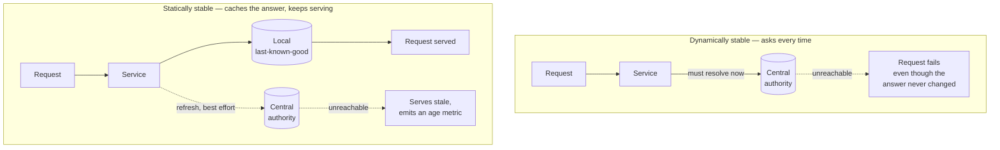

## The situation

Something in your architecture answers *"what is true?"* for everything else.
Service discovery, the config service, the token issuer, the feature flag
system, the metadata store, DNS. It is small, it is reliable, and almost
nothing is designed for its absence — because its absence sounds like a
problem you would notice before shipping.

Then it goes away, and the thing you discover is that nothing was broken
except the ability to *ask*. The data was still correct. The instances were
still running. They simply had no way to confirm what they already knew, and
so they stopped.

## The question

For every dependency, one question separates a contained failure from a
cascade:

> **When this is unreachable, can the system keep serving on what it last
> knew?**

A system that can is **statically stable**: its steady-state behaviour does
not require the control plane to be answering. A system that cannot has
converted a dependency's availability into its own, no matter what the
architecture diagram suggests.

The design is not clever. It is: **cache the answer locally, keep serving it
when the refresh fails, and make the age of what you are serving visible.**
What takes discipline is the third part and the decision of what may go stale,
which is the rest of this page.

## The failure this prevents, as it actually happened

In October 2025 a race condition in DynamoDB's automated DNS management left
an **empty** DNS record for the regional endpoint in us-east-1 — two
independent enactors applied plans out of order, and a cleanup step then
deleted the plan that held every IP address for the endpoint. Repairing it
needed a human.

The data in DynamoDB was fine. What broke was resolution. And then it spread,
because the things that depended on DynamoDB were not statically stable with
respect to it: EC2's lease management could not complete its state checks, so
leases expired; after recovery it fell into congestive collapse and had to be
restarted. Network Load Balancer health checks failed for instances whose
network state had not propagated, so nodes flapped in and out of DNS and
automatic failover removed capacity. Lambda, ECS, EKS, Fargate, STS and IAM
sign-in followed, mostly through the same two doors.

One empty record. The lesson is not "DNS is fragile" — it is that a long chain
of components each needing a live answer turns one outage into everyone's
outage.

## What to make statically stable

| Dependency | Fail-static move | Watch out for |
|---|---|---|
| **Service discovery / DNS** | Keep the last resolved set and keep using it past TTL when resolution fails | Serving a dead endpoint forever; pair with health checks |
| **Config and feature flags** | Cache last-known-good on local disk, boot from it if the service is unreachable | Boot order — a cold start that *requires* config is not static |
| **Authorisation policy** | Cache decisions with a short, explicit lifetime | Stale *allow* is a security failure; see below |
| **Token / JWKS verification** | Cache signing keys; verify locally rather than calling the issuer per request | Revocation becomes delayed by the cache lifetime |
| **Capacity** | Pre-provision for the failed state instead of scaling into it | "We will scale when the AZ fails" assumes the control plane works during the failure |

That last row is the version of this idea most often missed. Scaling up during
a failure is a request to a control plane at the moment control planes are
least likely to answer. Static stability for capacity means the surviving
zones were already running enough to carry the load — which costs money in
the steady state, and is what the money buys.

## Recovery is its own load profile

Surviving the outage is half of it. The other half is that everything comes
back at the same instant.

Google Cloud's June 2025 incident is the clean illustration. The trigger was a
quota policy check added without feature-flag protection; a policy change
containing blank fields replicated globally within seconds and crashed Service
Control worldwide on an unhandled null pointer. But the *long* part of the
outage was recovery: restarting tasks in large regions produced what the
report calls a "herd effect" on the underlying Spanner table, overloading it.
The us-central1 recovery took around two hours forty minutes, with task
creation deliberately throttled. Among Google's own follow-up actions: audit
systems for randomized exponential backoff, and feature-flag-protect all
changes to critical binaries, disabled by default.

So the restart stampede is not a special case of client retries — it is a
distinct load profile that only occurs when you are already in trouble:

- **Jitter every retry and every refresh**, not just request retries. Caches
  warming, leases renewing, workers reconnecting, cron jobs that all fire on
  the minute. See
  [Idempotency and Retries](/docs/system-design/idempotency-and-retries/).
- **Throttle your own recovery.** Bring capacity back in waves. A controlled
  40-minute recovery beats an uncontrolled 3-hour one.
- **Test the stampede, not just the failure.** Killing a dependency proves
  fail-static. Bringing it back proves the herd does not finish the job, and
  that is the half nobody rehearses.

## When the default is wrong

Fail-static is not free, and it is wrong in three places:

- **Stale means unsafe.** A revoked session, a withdrawn permission, a
  deleted record under a right-to-erasure request. Here "keep serving what we
  last knew" is the incident. Fail closed, and make that an explicit,
  documented choice rather than an accident of implementation.
- **Correctness beats availability.** Balances, inventory counts at the point
  of sale, anything where a wrong answer costs more than no answer. Serving a
  stale number is worse than an error message.
- **It hides the failure.** A system that degrades perfectly to last-known-good
  can run for days with a dead control plane and nobody noticing, until a
  second failure arrives and there is nothing left to fall back on. This is
  why the age metric is not optional: if you serve stale, **alert on
  staleness**, or you have traded an outage for a silent one.

## What it costs

**Every cache is a second copy with its own lifetime.** You now reason about
two states — fresh and last-known-good — in every code path that reads it, and
the stale path is the one that is never exercised in testing and always
exercised during an incident.

**Pre-provisioned headroom is money.** The capacity row above is a standing
bill in exchange for not needing a control plane on your worst day. It is
usually worth it and it is a real line item, not a free pattern.

**Staleness becomes a product question.** How old may this be? The answer
differs per field and per screen, and engineering cannot decide it alone.

**You have to practise it.** Fail-static code that has never run in anger is
a belief, not a property. The dependency map and the recovery drill are the
work — see
[Incident Response and Blameless Postmortems](/docs/reliability/incident-response/)
and [Rollback Is a Feature](/docs/delivery/rollback/). Without them, this page
is a diagram.

## See also

- [Failure Modes: Timeouts, Breakers, Bulkheads](../failure-modes/)
- [Capacity, Load Shedding, and Backpressure](../capacity-and-backpressure/)
- [SLOs, Error Budgets, and Saying No](../slos-and-error-budgets/)
- [Environments, Config, and Secrets](/docs/platform/environments-and-secrets/)
- [What Got Cheaper, and What Did Not](/docs/foundations/what-got-cheaper/)
