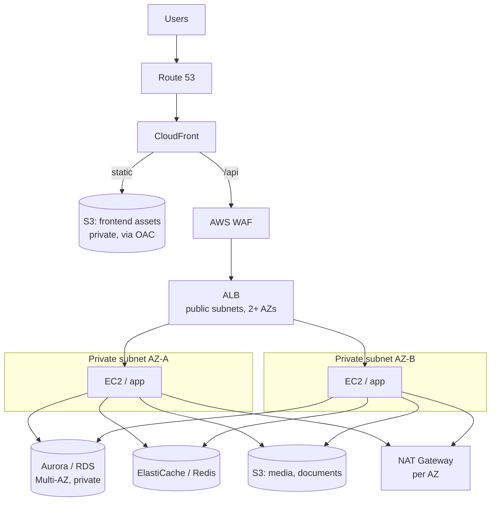

## The situation

Somebody needs a production web application on AWS, and the answer — correctly
— is the one everybody already knows: Route 53 in front, CloudFront and S3 for
the static frontend, an Application Load Balancer into an Auto Scaling group of
EC2 instances in private subnets, Aurora or RDS behind that with ElastiCache
alongside.

This is the most-deployed cloud architecture in existence and it is a good
default. It is also where the gap between the diagram and a system that
survives a Tuesday is widest, because every box on that diagram is easy to
create and several of them are easy to create *wrong* in a way nothing tells
you about until an AZ goes away.

**First, a name collision worth clearing up.** "Three-tier" here means a
*deployment* topology: three network and trust zones, with traffic flowing one
direction through them. That is a different decision from the layered code
structure — controller, service, repository — covered in
[Layered (N-Tier)](../layered/). You can run a perfectly layered codebase on
one EC2 instance, and you can run a tangled one across this topology. They
share a name and nothing else, and conflating them is how a team ends up
believing its network diagram says something about its code.

## The reference topology

| Tier | Services | What the tier actually owns |
|---|---|---|
| Presentation | Route 53, CloudFront, S3, WAF | TLS termination, edge caching, the public attack surface |
| Application | ALB, EC2, Auto Scaling | Business logic, and the only tier allowed to reach the data tier |
| Data | Aurora/RDS, ElastiCache, S3 | Durable state, and the thing you cannot scale by adding instances |

Worth stating plainly, because the tiers invite the opposite reading: the
separation is logical, not a count of subnets or servers. One tier routinely
spans two AZs, several subnets, and more than one service.

## The four things that separate this from a tutorial

**1. The security group chain is the architecture.** Not CIDR blocks —
security groups referencing *other security groups*. The ALB's group accepts
443 from the internet; the app group accepts the application port *from the ALB's
group*; the database group accepts the database port *from the app group*. No
rule anywhere names an IP range, so the rules stay correct as instances come
and go, which is the whole point when an Auto Scaling group is replacing hosts.
A `0.0.0.0/0` rule on the database group is not a misconfiguration to fix
later; it is a different architecture, and a worse one.

**2. Private subnets plus NAT, and the NAT is per AZ.** App instances need no
public IP merely to reach the internet outbound; a NAT Gateway handles that and
grants nothing inbound. The trap: one NAT Gateway in one AZ makes your
outbound path single-AZ while the diagram still shows two. When that AZ goes,
instances in the other AZ are up, healthy, serving traffic, and unable to reach
anything outside the VPC. A NAT Gateway per AZ with per-AZ route tables is the
fix, and it is the first thing to verify in an architecture claiming Multi-AZ.

**3. Stateless app instances are the precondition, not a nice-to-have.** Auto
Scaling terminates instances. If a user's session lives in local memory on
that instance, scaling in is a logout and scaling out is inconsistent
behaviour. Session state moves to Redis or the database before Auto Scaling is
switched on, not after the first complaint.

**4. IAM roles, not keys on disk.** An instance profile gives the application
credentials that rotate themselves. Access keys in a config file or an
environment variable are a credential with no expiry sitting on a host that an
Auto Scaling group will clone.

## The diagnostic that pays for itself

ALB status codes tell you which half of the system to look at, and knowing
this cold is worth more than any dashboard:

- **502** — the ALB reached your application and did not get a valid response.
  The target is up, your process is the problem: it crashed, it is listening on
  the wrong port, it closed the connection before the ALB's idle timeout, or it
  returned something malformed. Look at the application.
- **503** — the ALB had no healthy target to send to. Your process may be
  perfect and simply unreachable: health check path, health check thresholds,
  security group, or an Auto Scaling group at zero healthy capacity. Look at
  the target group, not the code.

And for "the site is slow", resist the EC2 CPU graph. The latency is somewhere
in CloudFront → ALB → application → Redis → database, and the database is the
usual answer: a missing index, a query that got expensive as the table grew, or
a cache-miss storm after an eviction. Walk the chain in order and measure each
hop; do not resize the instance first.

## When the default is wrong

- **Spiky or low-average traffic.** You are paying for warm capacity you are
  not using, and the minimum viable version of this topology — ALB, two
  instances, Multi-AZ RDS, NAT — has a floor of a few hundred dollars a month
  before a single user arrives. See
  [Serverless and Managed Services](../serverless/).
- **A small internal application.** CloudFront, WAF, and a two-AZ Auto Scaling
  group for a tool used by forty people in one office is ceremony. One instance
  and a managed database is the honest answer, and the topology is there when
  it is needed.
- **Many services deploying independently.** This topology is shaped for one
  application. Multiplied across twenty services it becomes twenty of
  everything, and the question becomes a platform question — see
  [Microservices: The Itemised Bill](../microservices/) and
  [Kubernetes: What You Sign Up For](/docs/platform/kubernetes-reality/).
- **The scaling constraint is the database.** Adding EC2 instances is easy and
  the database connection limit is not elastic. If the bottleneck is write
  throughput or connection count, Auto Scaling makes the outage arrive faster.

## What it costs

**You still own the instances.** AMIs, patching, the agent on the host, the
golden-image pipeline. Managed load balancing and managed databases hide a lot;
the application tier is yours, and that is the recurring work this style never
removes.

**The NAT Gateway is a line item that scales with traffic, not with load.**
Per-GB data processing on every outbound byte, per AZ. Teams discover it when
an application starts pulling container images or large objects through NAT
rather than a VPC endpoint. Check it before it is a surprise.

**Four scaling knobs that do not move together.** EC2 scales horizontally in
minutes, RDS vertically with a failover, ElastiCache by reconfiguration, and
connection limits not at all without RDS Proxy or a pool you tuned yourself.
"We scaled" almost always means the application tier only, and the next
constraint is one tier down.

**The cache is a second source of truth.** ElastiCache earns its place and it
brings the four questions with it: TTL, invalidation on write, behaviour when
Redis is unavailable, and whether stale data is acceptable in this screen. Each
needs an answer per use case, not one global policy. See
[Caching: The Four Questions](/docs/data-and-state/caching/).

**Multi-AZ is a claim, and claims decay.** It is true on the day you build it
and quietly false after someone adds a resource in one AZ, a single NAT, or a
subnet that routes somewhere unexpected. The only honest verification is to
remove an AZ's capacity deliberately and watch what happens — in a lower
environment first, then in production, on a schedule. Until you have done that,
"highly available" is a diagram, not a property.

## Worked example

A detailed, service-by-service walkthrough of this topology — including the
security group chain, the failure scenarios above, and security, performance
and availability checklists — is published as public study notes:
[rahatdevops/3-Tier-AWS-Production-Architecture-Study-Notes](https://github.com/rahatdevops/3-Tier-AWS-Production-Architecture-Study-Notes).
This page is an opinionated reading of that architecture, not a summary of it.

## See also

- [Layered (N-Tier): The Style Nobody Chose](../layered/) — the same name, a different decision
- [Serverless and Managed Services](../serverless/)
- [Caching: The Four Questions](/docs/data-and-state/caching/)
- [Failure Modes: Timeouts, Breakers, Bulkheads](/docs/reliability/failure-modes/)
- [Least Privilege and Auditability](/docs/security/least-privilege/)
