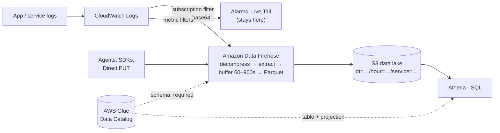

## The situation

Log volume has grown to the point where the bill is a line item somebody asks
about in a meeting. The log platform charges by the gigabyte ingested and again
to keep it searchable, retention has been quietly cut to 14 days to control
that, and now compliance wants 12 months and an auditor wants to know who read
a particular record in March.

The AWS answer to this is not a product, it is a combination that has become
the house standard: CloudWatch Logs or an application stream into **Amazon Data
Firehose**, which buffers, converts the records to **Parquet**, and writes them
to **S3**; **Athena** then queries them in place with SQL. No cluster, no
index, no ingest-time licence.

## The style, and the one decision underneath it

Every log architecture answers one question: *do you pay at write time or at
read time?*

| | Indexed search (Splunk, Datadog, OpenSearch, ELK) | Query-in-place (S3 + Parquet + Athena) |
|---|---|---|
| Pay at | Ingest and hot retention | Query — per TB scanned |
| Search latency | Sub-second | Seconds to minutes |
| Free-text needle-hunting | What it is built for | A full scan wearing a SQL hat |
| Retention economics | Punishing | Nearly free, and the reason you are here |
| The thing that must be right | Index and field mapping | **Partition layout** |

That last row is the whole style. There is no index, so **the partition layout
is the index**. A query constrained on partition columns reads a few objects; the
same query without them reads the bucket. Cost and latency here are a function
of your prefix scheme, not of how much data you have.

Note what the diagram says about CloudWatch Logs: it does not go away. Alarms
and live tail need seconds-fresh data and stay where they are. The lake is the
*history*, and you are running both.

## The four things that bite

**1. Firehose needs a Glue schema, and silently drops what it does not know.**
Record format conversion is not schema-on-read. Firehose reads JSON through a
deserialiser, consults a table in the **AWS Glue Data Catalog** for the schema,
and serialises to Parquet. Per AWS's own documentation: *"the converted data
will not contain attributes that are not specified in the schema."* So a
developer adding a field to a log line gets no error, no warning, and no
field — it is dropped at conversion and discovered months later when somebody
tries to query it. Schema changes to the catalogue have to be part of the same
deploy as the logging change, or this style quietly loses data.

Related: the input must be JSON. Anything else needs a Lambda transform to
make it JSON first.

**2. CloudWatch Logs does not arrive as log lines.** A subscription filter
delivers records that are base64-encoded, gzip-compressed, and contain a
`logEvents` *array* — many events per record, wrapped in metadata. Point that
straight at Parquet conversion and you get a table whose rows are compressed
blobs. It has to be decompressed and the messages extracted first: Firehose has
built-in decompression and message extraction for exactly this source, or a
Lambda transform does it. This is the single most common way the pipeline is
wired wrong on the first attempt.

**3. Partition projection, once the table is highly partitioned.** By default
Athena calls `GetPartitions` against Glue before pruning, and on a table with
tens of thousands of date-hour partitions that lookup becomes the slow part of
a fast query. Partition projection has Athena compute partition values from
table properties instead, which also removes the chore of registering new
partitions as time passes. Two caveats worth knowing before you enable it:
Athena then **ignores** registered partition metadata for that table, and if
more than half your projected partitions are empty, AWS recommends going back
to real partitions.

Also: Firehose's default S3 prefix is `YYYY/MM/DD/HH` in UTC, which is not
Hive-style `key=value`. Either set a custom prefix or dynamic partitioning on
the Firehose side, or configure a custom storage-location template on the
Athena side. Pick one deliberately; discovering the mismatch after a month of
data has landed means rewriting prefixes.

**4. Buffering is the freshness floor.** Firehose buffer interval hints run
**60 to 900 seconds**, and with dynamic partitioning the multi-stage buffering
can make end-to-end delay around 1.5× the hint. This style is minutes-fresh by
construction. That is fine for investigation and useless for paging, which is
exactly why alarms stay in CloudWatch.

## The trade at the centre: freshness versus file size

Shorten the buffer and data arrives sooner in more, smaller Parquet files.
Lengthen it and queries get faster while the data gets staler. You cannot have
both, and the small-files problem is real: thousands of tiny objects per hour
means per-object overhead dominates query time, and Athena spends its time
opening files rather than reading columns.

The usual resolution is two tiers rather than one setting — land at whatever
freshness you need, then run a compaction job that rewrites recent partitions
into larger files on a schedule. Budget for that job up front. It is the piece
most teams discover only when a three-month query starts timing out.

## When the style is right

- **Retention is the cost driver.** Access logs, CDN logs, VPC flow logs,
  audit trails, anything kept for a year because somebody has to be able to
  ask about it later.
- **The questions are analytical, not needle-hunting.** Top talkers, error
  rates by version, traffic by customer, cost attribution. SQL over columns is
  genuinely better at these than a search box.
- **Logs need joining to other data.** Once logs are Parquet on S3, they are
  just another table next to your warehouse exports.
- **You want one storage layer, not a log silo.** This is the observability-
  shaped instance of the lakehouse idea — see
  [Data Platform Styles](../data-platform/).

## When the default is wrong

- **Interactive incident debugging.** At 3am you want to grep a stack trace
  across the last 20 minutes and get an answer in a second. That is an index's
  job. Keep CloudWatch Logs Live Tail, or an OpenSearch cluster, for the recent
  window, and let the lake own history.
- **Alerting.** Minutes-late data cannot drive a page. Metric filters and
  alarms belong upstream, on the live stream.
- **Low volume.** At a few gigabytes a month this is four services, a
  catalogue, a compaction job and an IAM surface to replace a retention setting.
- **Unstable log schemas.** If log structure changes weekly, the Glue schema
  becomes a permanent tax and the silent-drop failure above will catch you
  repeatedly. Land raw JSON and convert later, or fix the logging discipline
  first.

## What it costs

**A bad query is a budget event.** Athena bills per terabyte scanned. `SELECT *`
on an unpartitioned table across a year of logs is a single statement that costs
real money and teaches the lesson once. Workgroup query limits and
per-query data scanned caps exist for this reason — set them before handing out
access, not after.

**Ingestion is priced per record, rounded up.** Firehose charges by record
count with each record rounded up to the nearest 5 KB, so the *same bytes*
split into many small records cost more. High-frequency, tiny log lines are the
expensive shape. Batch at the source where you can.

**The Glue catalogue becomes a coupling point.** The logging code, the Firehose
conversion, and every Athena query share one schema definition. It needs an
owner and it needs to be in version control with the rest of the
infrastructure — see
[Infrastructure as Code That Doesn't Drift](/docs/platform/infrastructure-as-code/).

**You are operating two log systems, not one.** Live data in CloudWatch, history
in S3, two query languages, two mental models, two places to look during an
incident. That is the honest cost of the split, and it is worth paying only
when retention economics justify it.

**Nothing is full-text indexed.** "Which requests contained this
correlation ID" over 90 days is a scan. You can make it cheap with good
partitioning and columnar projection; you cannot make it a search.

## See also

- [Data Platform Styles: Lakehouse and What Sits Around It](../data-platform/)
- [Observability: What to Actually Wire](/docs/reliability/observability/)
- [Three-Tier on AWS: The Reference Topology](../aws-three-tier/)
- [Serverless and Managed Services](../serverless/)
- [Caching: The Four Questions](/docs/data-and-state/caching/)
